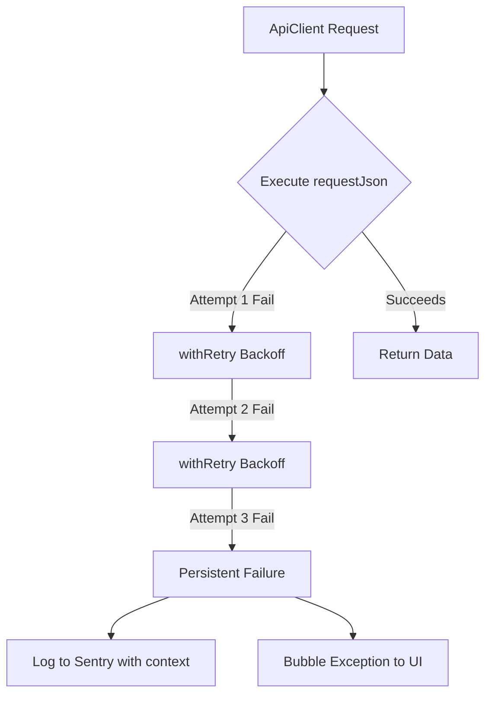

# Frontend Observability & Reliability Standards (Wave 5)

This document outlines the architecture, standards, and runtime strategies implemented to guarantee production-grade observability and network-level resilience for the Stardial frontend.
<!-- 
This fix addresses GitHub Issue #292 (Security: Cross-Site Scripting (XSS) in Split Description Field) by implementing comprehensive XSS prevention across the entire application using a 3-layer defense strategy. -->
<!-- 
This fix addresses GitHub Issue #292 (Security: Cross-Site Scripting (XSS) in Split Description Field) by implementing comprehensive XSS prevention across the entire application using a 3-layer defense strategy. -->
---

## 1. Centralized Observability & Telemetry

We utilize **Sentry** (`@sentry/nextjs`) as our central telemetry aggregator to capture React render errors, client-side runtime exceptions, Edge routing failures, and API interaction bugs.

### Configuration Topology
The Sentry agent is initialized across all target runtimes:
*   **Browser/Client (`sentry.client.config.ts`)**: Captures client-side React component crashes, user-triggered action exceptions, wallet hooks, and REST/RPC client network failures.
*   **Server Runtime (`sentry.server.config.ts`)**: Monitors Node.js server-side renders (SSR) and API routes execution.
*   **Edge Runtime (`sentry.edge.config.ts`)**: Observes Edge middleware and localized request proxying routes.

### PII & Security Redaction (Privacy Guardrail)
To ensure compliance and privacy, **all Stellar wallet addresses (G...) and smart contract IDs (C...)** are redacted from telemetry payloads before transmission.
*   **Rule:** Standard ed25519 public keys and contract IDs matching `\b[GC][A-Z2-7]{55}\b` are regex-replaced with `[WALLET_REDACTED]`.
*   **Location:** Configured globally inside `beforeSend` of the client initialization options.
*   **Bypass Control:** Standard environment configurations (`NEXT_PUBLIC_SENTRY_SCRUB_WALLET_ADDRESSES="false"`) allow disabling scrubbing only under local sandboxed debugging.

---

## 2. API resilience (Resilient Retries)

To mitigate transient network failures, latency spikes, or temporary backend drops, the frontend incorporates automated retries for all network interactions through `ApiClient`.

### Mechanics
*   **Target Scope:** Every JSON request orchestrated via `ApiClient.requestJson` (including project fetching, stats aggregation, allowlist lookup, and XDR compilation).
*   **Retry Policy:** up to **3 attempts** with a base backoff delay of **500ms** (exponential backoff).
*   **Error Logging:** Sentry logging is deferred to the final failure attempt. If the request succeeds during any retry, no error is sent to Sentry, avoiding alert noise.
*   **UI Graceful Degradation:** When all retries are exhausted, the error is bubbled up to the React layer, triggering the local `AppErrorBoundary` or displaying a user-friendly recovery toast.

---

## 3. Blockchain & Smart Contract Observability

On-chain operations require specialized telemetry to capture transaction assembly and execution anomalies.

### Soroban RPC Instrumentation
In `frontend/src/lib/soroban-transaction.ts`, we intercept transactions at two crucial stages:
1.  **Submission (`sendTransaction`)**:
    *   If the RPC node rejects the transaction (e.g., due to bad sequence numbers, fee mismatch, invalid signatures), Sentry captures the error accompanied by the `status` and `errorResult` XDR payload.
2.  **Polling (`pollTransaction`)**:
    *   **Failure State:** If the ledger executes the transaction but fails (e.g., contract panics, assertion failures), Sentry logs the error along with the transaction `resultXdr` to facilitate debugging.
    *   **Timeout State:** If the transaction is not confirmed within the threshold, Sentry receives a `poll` timeout event containing the transaction `hash` to investigate potential ledger congestion.

---

## 4. Wallet Connection Telemetry

User actions in `useWallet` hook (`connect` / `refresh` methods) log failed initialization triggers or connection blockages directly to Sentry (categorized under the `wallet-hook` tag). This ensures developers can monitor cross-browser/wallet driver bugs in real-time.

---

## 4a. Split Lifecycle Telemetry

The primary split actions emit structured lifecycle events through `frontend/src/lib/telemetry.ts`. The instrumented actions are `create`, `deposit`, `distribute`, `lock`, `update_metadata` and `update_collaborators`.

| Stage | When |
| --- | --- |
| `started` | The user starts the action (before the XDR is built) |
| `submitted` | The RPC accepts the signed transaction and returns its hash |
| `succeeded` | The ledger confirms the transaction (terminal) |
| `failed` | Any step throws (terminal) and includes `errorKind`: `user_rejected`, `timeout`, `network`, `contract` or `unknown` |

*   **Event names** follow `split.<action>.<stage>`, for example `split.deposit.failed`. Each event includes `projectId`, `durationMs` (time since `started`), `txHash` once one is known, and a few non-PII props such as `collaboratorCount` and `round`.
*   **Transport:** every event is recorded as a Sentry breadcrumb (category `split.lifecycle`). This means any error report shows the lifecycle steps that led to it. Other analytics tools can subscribe with `registerTelemetrySink(fn)`.
*   **Privacy:** events never include wallet addresses. Failure messages pass through the same `[GC][A-Z2-7]{55}` redaction and are cut to 300 characters.
*   **Safety:** a failure in Sentry or in a sink is caught and ignored, so telemetry never interrupts a user action. Each tracker sends at most one terminal event.
*   **Tests:** `frontend/src/__tests__/telemetry.test.ts`.

---

## 4b. Duplicate Submission Protection (#1266)

Payment and split actions (create, deposit, distribute, lock) go through `useSubmissionGuard` (`src/hooks/useSubmissionGuard.ts`) and the helpers in `src/lib/submission-guard.ts`.

- **Single flight per action.** `run(action, task)` takes a synchronous lock held in a ref. A double click, a repeated Enter press, or a "Retry" fired before React re-renders can't start a second submission, even though the button's `disabled` attribute hasn't updated yet. The lock is released when the task settles.
- **Idempotency key for create.** `POST /splits` is sent with an `Idempotency-Key`. The key is reused while the payload is unchanged, so a retry after a build or signing failure gets the backend's replayed response. It's rotated as soon as the transaction is submitted, because the built XDR's sequence number is then spent, and also after a `409 idempotency_key_conflict`. With a key on the request, the API client's automatic 5xx retries are safe too.
- **Definitive vs. unconfirmed failures.** Wallet rejections, build errors, RPC rejections and ledger failures are definitive, so controls come back. A poll timeout (`TimeoutError`) means the transaction reached the network with an unknown outcome. The action then stays disabled, and a "Waiting for network confirmation" notice offers **Check status**:
  - `SUCCESS` or `FAILED` from `getTransaction` unblocks the action.
  - `NOT_FOUND` keeps it blocked until the transaction's validity window (300s plus 60s margin) has passed, after which it can no longer land.
  - RPC errors keep it blocked.
- **Navigation.** While a submission is in flight or unconfirmed, leaving the page triggers the browser's "Leave site?" prompt.

## 4c. Accessible Form Errors (#1267)

The split creation form and the deposit form follow the error-summary pattern:

- **Errors are tied to their fields.** Every invalid field sets `aria-invalid="true"` and points `aria-describedby` at its error text. A share-total error is also linked from every share field (`#allocation-status`). `TokenPicker` accepts an `id` so a summary link can target it.
- **Submit buttons stay focusable.** They are `aria-disabled` while the form is invalid, rather than `disabled`, so keyboard and screen reader users can reach them and find out what's wrong. They are truly `disabled` only while a submission is in flight.
- **Summary for multiple errors.** A failed submit with two or more errors shows `FormErrorSummary` (`src/components/FormErrorSummary.tsx`). Focus moves to it, it's announced by its heading ("There are N problems with this form"), and each item links to and focuses its field. With a single error, focus goes straight to that field.
- **Focus only moves on submit.** It never moves while the user types. `useForm` uses `shouldFocusError: false` so react-hook-form doesn't compete with the summary for focus.

### Pre-Deployment Verification Checklist
1.  **Verify Sentry Webpack Plugin:** During `npm run build`, verify that Next.js automatically generates and uploads source maps to Sentry. Ensure `SENTRY_AUTH_TOKEN` is configured in CI.
2.  **Validation Run:** Execute `npm run test` to verify retry policies and telemetry triggers.
3.  **Local Env Check:** Ensure `NEXT_PUBLIC_SENTRY_DSN` is correctly set in staging/production envs.

### Rollback Strategy
If telemetry issues cause performance degradation or memory leaks:
1.  **Observability Mute:** Unset `NEXT_PUBLIC_SENTRY_DSN` in Vercel settings and redeploy. Sentry will safely bypass initialization without breaking application logic.
2.  **Telemetry Scrubbing Rollback:** If the regex scrubber causes CPU overhead, set `NEXT_PUBLIC_SENTRY_SCRUB_WALLET_ADDRESSES="false"` to bypass redaction.
3.  **Network Revert:** To rollback API changes, revert the deployment to the previous stable Vercel deployment tag.